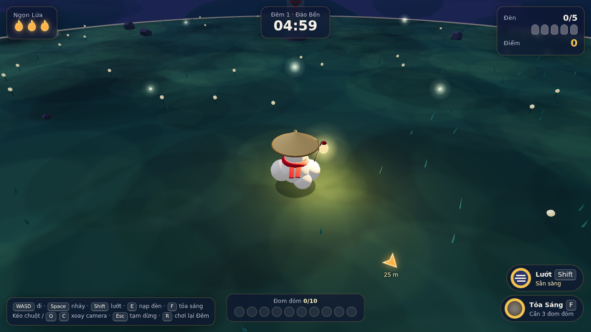

# Đảo Đèn Lồng

**Video demo (4 phút 55 giây):** [demo.mp4 trên Release v1.0.0](https://github.com/manhtuongqt/K5-L3A-DAY12-NguyenManhTuong-2A202603646-AI-SDLC-Dao-Den-Long/releases/download/v1.0.0/demo.mp4) · [bản trong repo](docs/demo/demo.mp4) · **Bản phát hành:** [v1.0.0](https://github.com/manhtuongqt/K5-L3A-DAY12-NguyenManhTuong-2A202603646-AI-SDLC-Dao-Den-Long/releases/tag/v1.0.0)

> Video gồm: 3 phút 18 giây chơi Đêm 1 (quay vùng cửa sổ game), 1 phút chơi Đêm 3 toàn màn hình, 36 giây terminal. Phần terminal được dựng thành trang từ output thật của `npm test`, `scripts/verify.sh`, `soak.json`, `bench.json` và lệnh headless chạy lúc 20:24 ngày 2026-11-20 (không quay màn hình được phần này).

Game 3D góc nhìn thứ ba: Mây, người giữ đèn nhỏ tuổi, gom đom đóm để thắp và giữ sáng các Đèn Lồng Lớn tới bình minh, né Bóng Mực trong sương đen, qua 3 Đêm trên 3 hòn đảo.

Bài lab Day 12 AI SDLC, K5 L3A. Nguyễn Mạnh Tường, 2A202603646. Engine: Three.js r170 (web, WebGL 2) + Node.js. Test Contract **v1.3**.



## Yêu cầu hệ thống
- macOS hoặc Linux (Windows chạy được qua trình duyệt).
- Node.js ≥ 20 (đã thử với v22), npm.
- Chrome/Chromium hoặc trình duyệt có WebGL 2. Benchmark cần Chrome/Chromium (đặt `CHROME_PATH` nếu không tìm thấy).

## Cài đặt và chạy (3 lệnh)
```bash
npm ci
npm run build
npm start          # mở http://localhost:5173 (server Node phục vụ bản build + lưu bảng xếp hạng)
```
Phát triển: `npm run dev` (Vite, có hot reload; bảng xếp hạng khi đó lưu localStorage).

## Điều khiển (đổi được trong Cài đặt → Đổi phím)
| Phím mặc định | Hành động |
|---|---|
| W A S D / mũi tên | Di chuyển (theo hướng camera) |
| Kéo chuột trái, Q / C | Xoay camera |
| Space | Nhảy |
| Shift | Lướt |
| E | Thắp đèn / châm dầu |
| F / chuột phải | Tỏa Sáng (tốn 3 đom đóm) |
| Esc / P | Tạm dừng (Tiếp tục, Chơi lại Đêm, Cài đặt, Về menu) |
| R | Chơi lại Đêm |

Cài đặt (lưu lại): âm lượng, độ nhạy chuột, đổi phím (báo trùng, khôi phục mặc định), bảng màu dễ phân biệt (mù màu), giảm chuyển động, chữ lớn ×1.25.

## Luật và cách tính điểm
- **Mục tiêu:** giữ đảo sáng tới bình minh. Hết giờ mà còn sống và số đèn **đang sáng** ≥ 60% (Đêm 1: 3/5, Đêm 2: 4/6, Đêm 3: 5/7) thì thắng.
- 3 Đêm: Đảo Bến (5 đèn, 240 s), Đảo Cau (2 đảo, cầu tre, bục nhảy, 6 đèn, 270 s), Đảo Chuông (3 tầng, dốc, tháp chuông, gió mạnh, 7 đèn, 300 s). Mỗi Đêm 3 Ngọn Lửa.
- Đom đóm tự nhặt; sức chứa 10, +2 mỗi lần thắp đèn (tối đa 20). Đèn tắt cần 10 đom đóm (đèn từng sáng: 5); đèn sáng hao 1 dầu/s, châm +10 dầu mỗi đom đóm.
- Bóng Mực đuổi trong 12 m; chạm vào mất 1 Ngọn Lửa và rơi nửa số đom đóm. Đèn có dầu ≥ 30 tạo vùng an toàn 6 m; đèn yếu bị Bóng Mực hút dầu. Gió Lạc cướp đom đóm, Bùa Gió tăng tốc. Rơi khỏi đảo mất 1 Ngọn Lửa.
- **Điểm:** +5 mỗi đom đóm nạp, +100 thắp lần đầu, +40 thắp lại, +5 mỗi Bóng Mực trúng Tỏa Sáng (+15 nếu đang hút dầu); khi thắng +50 + số dầu mỗi đèn sáng và +50 mỗi Ngọn Lửa. Tổng điểm = tổng các Đêm đã thắng; lưu vào **Bảng xếp hạng** (top 10) sau Bình Minh hoặc khi thua.
- Mọi con số: [game.contract.json](game.contract.json). Chi tiết: [ADR 0001](docs/adr/0001-lantern-fuel-and-dawn-win.md), [phase-2-design.md](docs/notes/phase-2-design.md).

## Test, headless, benchmark, soak
```bash
npm test                         # 286 test (node:test): contract, luật, bench, soak, bảng xếp hạng
scripts/verify.sh                # test + tất định 3 đêm + hiệu năng 21 600 tick
node src/headless.js --seed 1 --night 1 --ticks 600 --out out.jsonl [--scenario s.json] [--inputs i.json] [--snapshot-every 10]
node scripts/bench.mjs --seed 42 --duration 30 --out bench.json            # cần npm run build trước
node --expose-gc --no-opt --no-maglev scripts/soak.mjs --seed 7 --nights 10 --out soak.json
node scripts/play.mjs --export-leaderboard out.json                        # xuất bảng xếp hạng
```
- **Headless:** mã thoát 0 thành công, 2 file inputs/scenario sai định dạng, 1 lỗi tham số.
- **Benchmark:** mở Chrome thật (cửa sổ, viewport 1280×720) với `--disable-gpu-vsync --disable-frame-rate-limit` (**vsync tắt**), chạy cảnh chuẩn, đo qua CDP. `peak_mem_mb` là tổng RSS các tiến trình Chrome của lần đo. Số tự đo: [bench.json](bench.json) (Intel UHD tích hợp: avg 84.1 FPS, load 2.1 s; p1_low 5.8 do khựng định kỳ khi tắt vsync trên Mesa/Wayland, xem [proof](docs/proof/README.md)).
- **Soak:** chạy với tầng JIT tối ưu của V8 tắt để đo bộ nhớ của game thay vì bộ nhớ trình biên dịch, lý do và số liệu: [ADR 0002](docs/adr/0002-soak-memory-and-v8-jit.md). Kết quả: [soak.json](soak.json).

## Tài liệu
| Nội dung | Vị trí |
|---|---|
| Đề từng phase | [phase-1-prd](docs/notes/phase-1-prd.md), [phase-2](docs/notes/phase-2-ticket.md), [phase-3](docs/notes/phase-3-ticket.md), [phase-4](docs/notes/phase-4-ticket.md) |
| Giả định, đặc tả, quyết định | [assumptions.md](docs/notes/assumptions.md), [phase-1-design](docs/notes/phase-1-design.md), [phase-2-design](docs/notes/phase-2-design.md), [phase-4-design](docs/notes/phase-4-design.md), [ADR](docs/adr/) |
| Test bị đổi do luật mới | [phase-2](docs/notes/test-changes-phase-2.md), [phase-3](docs/notes/test-changes-phase-3.md), [phase-4](docs/notes/test-changes-phase-4.md) |
| Bằng chứng kiểm chứng | [docs/proof/README.md](docs/proof/README.md) |
| Nhật ký AI, token, retro | [ai-log.md](docs/notes/ai-log.md), [retro.md](docs/notes/retro.md) |
| Thay đổi, ghi nguồn, giấy phép | [CHANGELOG.md](CHANGELOG.md), [CREDITS.md](CREDITS.md), [LICENSE](LICENSE) |
| Harness AI | [AGENTS.md](AGENTS.md), [CLAUDE.md](CLAUDE.md), skill [verify-proof](.claude/skills/verify-proof/SKILL.md), hook [stop-verify.sh](.claude/hooks/stop-verify.sh), [CI](.github/workflows/verify.yml) |

## Sáng tạo của tôi
- Mây (thiết kế gốc) tóc bạch kim tết hai bím, vạch sơn trắng trên má, đội nón lá, quàng khăn đỏ, cầm đèn lồng nhỏ; đom đóm hoạt hình có cánh vỗ và bụng phát sáng ([ảnh](docs/proof/phase-2/creative-may-redesign.png)).
- Lời dẫn của Ông Đăng cho từng Đêm; âm thanh tự tổng hợp bằng WebAudio (không dùng file ngoài).
- Hiệu ứng: cột sáng và vòng an toàn của đèn, vòng sáng khi Tỏa Sáng, vệt lướt, lá bay báo trước gió, đom đóm rơi nhấp nháy khi sắp tắt.
- Tất cả chỉ ở phần hiển thị (`src/client/`), không đổi logic. Bằng chứng: 286 test headless đạt và output headless 3 đêm tất định, giống từng byte giữa Phase 3 và Phase 4 (sha256 trong [verify.txt](docs/proof/phase-4/verify.txt)). Cảnh bench và soak không dùng phần sáng tạo thêm ngoài hình nhân vật chuẩn.
